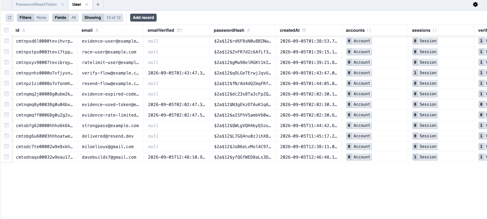
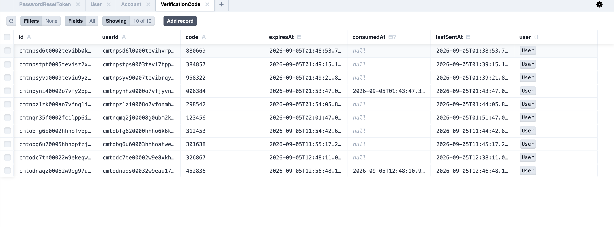
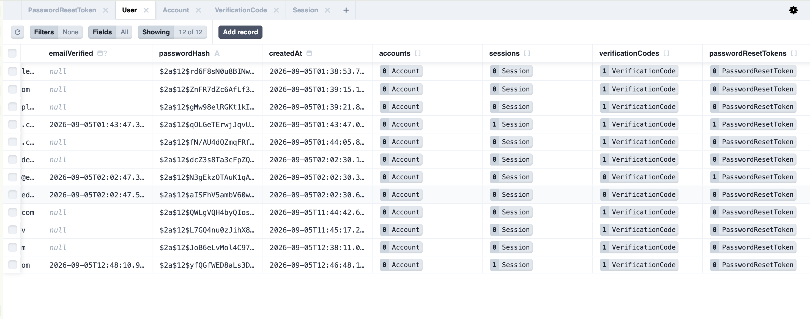
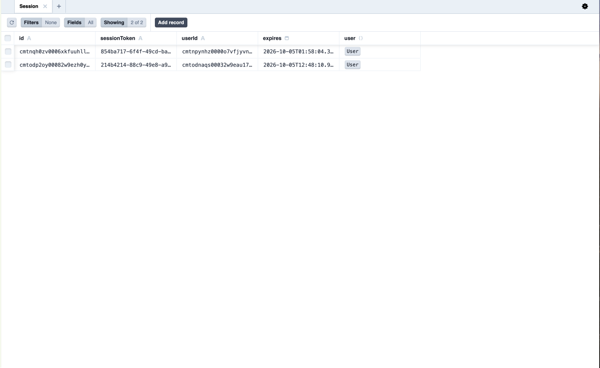
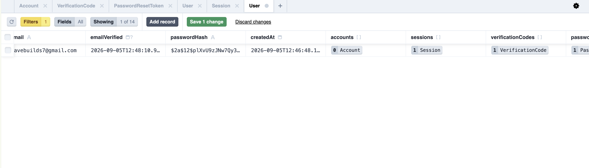
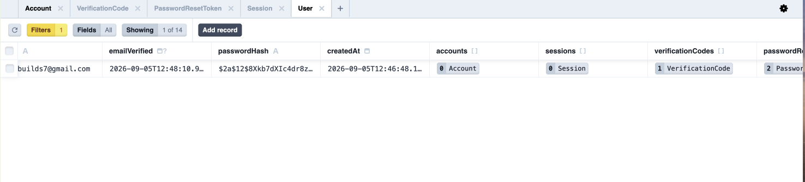
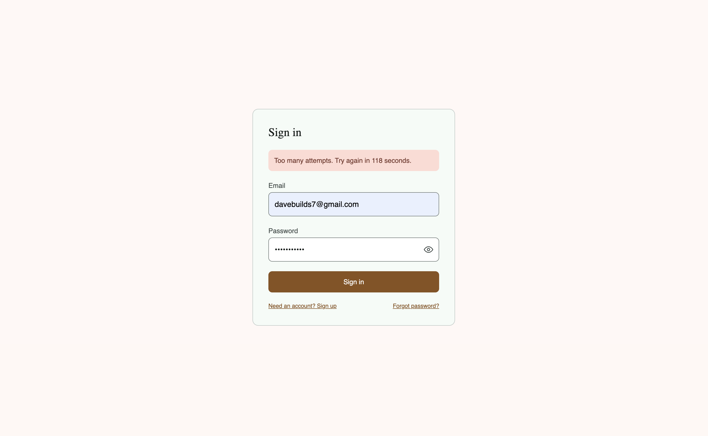

What this is?

Application Manager Track is an AI-powered job application manager and helps you customize your CV to a particular job description. This slice contains the whole authentication system. Users can register, verify their email address using a 6-digit code, sign in, request password resets, and sign out. The flow ends with a minimal placeholder dashboard showing the signed-in user's email and a sign-out button. All interactions are protected by server-side validation, database-enforced expiry, rate limiting, and proper session management.

This repository intentionally contains nothing but authentication. No landing page. No ads. No profile editing. No settings. No social login. No two-factor authentication. The dashboard is just an email address and a button. This focus means we are only testing the authentication logic itself, and it has to stand up to scrutiny: hashing, session management, rate limiting, and idempotency.

How To Run It
Clone the repository:

bash
git clone https://github.com/Hennit-Dave/Jobapplicationmanager-assessment-1.git
cd Jobapplicationmanager-assessment-1

Install dependencies:

bash
npm install

Set up environment variables:

Copy the example file: cp .env.example .env
Open .env and fill in these values manually (never commit this file):
DATABASE_URL: Your PostgreSQL connection string (from Neon, Supabase, or local).
AUTH_SECRET: A random string (generate via openssl rand -base64 32).
NEXTAUTH_URL: http://localhost:3000 for development.
VERIFY_EMAIL_TOKEN_SECRET: A second random string (also via openssl rand -base64 32), used to sign the short-lived token that scopes a signed-up-but-unverified user to the /verify-email screen.
UPSTASH_REDIS_REST_URL & UPSTASH_REDIS_REST_TOKEN: From your Upstash console.
RESEND_API_KEY: From your Resend dashboard.
EMAIL_FROM: The "from" address for outgoing mail (a Resend sandbox address like onboarding@resend.dev works without a verified domain, but Resend's sandbox mode will only actually deliver to your own account email or its test addresses such as delivered@resend.dev).

Run database migrations:

bash
npx prisma migrate dev

Start the development server:

bash
npm run dev

Access the application:
Open http://localhost:3000/signup in your browser. (/ itself just redirects to /signin — there is no landing page by design.)

To generate the database states needed for evidence screenshots (an expired code, a used reset token, a rate-limited account) without waiting on real timers, run:

bash
npm run seed:evidence

The Flow, Step By Step
Flow 1: Sign Up
User Action: Submits email and password on /signup.

Frontend Sends: POST /api/signup with { email, password }. Client-side Zod validation (via react-hook-form + the shared schema) runs first for instant feedback, including a live password-requirements checklist.

Server Does: Validates input via the same Zod schema. Checks if the email exists (case-insensitively, since it's normalized to lowercase before storage). If it doesn't, hashes the password with bcrypt (cost 12), creates a User row with emailVerified: null, generates a 6-digit code with a 10-minute expiry in verification_codes, sends it via Resend, and returns a token (as an httpOnly cookie) scoping the browser to /verify-email. If the email exists and is already verified, or exists and is unverified, the response is identical either way (nothing sent for a verified account; the existing code re-sent, cooldown permitting, for an unverified one) — this prevents account enumeration. A concurrent duplicate signup for a brand-new email is caught via the User.email unique constraint, not a race-prone check-then-insert.

Files: app/api/signup/route.ts, app/signup/page.tsx, lib/validation/auth.ts, lib/auth/password.ts, lib/auth/verificationCode.ts, lib/auth/verifyEmailToken.ts.

Flow 2: Email Verification
User Action: Enters the 6-digit code on /verify-email.

Frontend Sends: POST /api/verify-email with { code }.

Server Does: Reads the verify-email-scoped token from its httpOnly cookie to identify the pending user. Inside one database transaction: looks up the code, checking expiresAt > now() and consumedAt IS NULL; on success, marks the code consumed, sets User.emailVerified = now(). Outside the transaction, it then creates a session directly via the Auth.js Prisma adapter (not by re-running any sign-in logic, since we only have a code here, not a password) and sets the authjs.session-token cookie in Auth.js's own format, then redirects to /dashboard.

Files: app/api/verify-email/route.ts, app/api/verify-email/resend/route.ts, app/verify-email/page.tsx, lib/auth/manualSession.ts.

Flow 3: Sign In (Custom Route)
User Action: Submits email and password on /signin.

Frontend Sends: POST /api/signin with { email, password }.

Server Does: Rate-limit check first, before anything else. Looks up the user by email. If emailVerified is null, rejects with a distinct error code (the client redirects to /verify-email). Otherwise compares the password with bcrypt.compare() against passwordHash. On success, creates a session directly via the Auth.js Prisma adapter and sets the session cookie, exactly as email verification does.

Why custom, not Auth.js's Credentials provider? Auth.js v5 (@auth/core) refuses to run any /api/auth/* endpoint — not just sign-in, but session reads and sign-out too — when a Credentials provider is the only configured provider and session.strategy is "database". This was confirmed by actually running it (UnsupportedStrategy: Signing in with credentials only supported if JWT strategy is enabled), not just reading the docs. Since database sessions are non-negotiable here (see "Session Management" below), the Credentials provider was dropped and its logic reimplemented in a plain route handler. This route still uses Auth.js's real adapter to create the session — the session table, cookie format, and everything downstream (auth(), signOut()) work exactly as if Auth.js had done it.

Files: app/api/signin/route.ts, app/signin/page.tsx, lib/auth/rateLimit.ts.

Flow 4: Password Reset
User Action: Requests a reset on /forgot-password, then submits a new password on /reset-password/[token].

Frontend Sends: POST /api/forgot-password with email, then POST /api/reset-password with { token, password }.

Server Does: The forgot-password endpoint always returns the same generic response whether or not the account exists, and only if it does, generates a single-use token with a 30-minute expiry and emails a link. The reset endpoint hashes the new password first, then inside one atomic transaction: checks the token is unexpired and unused, marks it used, writes the new passwordHash, and deletes every Session row for that user — so a password change immediately invalidates every device that was signed in, not just the one making the request.

Files: app/api/forgot-password/route.ts, app/api/reset-password/route.ts, app/forgot-password/page.tsx, app/reset-password/[token]/page.tsx.

Flow 5: Protected Dashboard
User Action: Visits /dashboard.

Server Does: app/dashboard/page.tsx is a server component that calls Auth.js's auth() helper and checks the result before returning any JSX. If there's no valid session, it calls redirect("/signin") from next/navigation, which sends a 307 redirect — no dashboard markup is ever generated or sent to the browser. There is no middleware.ts in this project; PRD v3 explicitly allows either a server component or middleware for this check, and the server-component approach was chosen since it works cleanly with database sessions (Prisma) without needing an Edge-compatible session lookup.

Files: app/dashboard/page.tsx, app/dashboard/sign-out-button.tsx.

Flow 6: Sign Out
User Action: Clicks "Sign out" on the dashboard.

Server Does: Auth.js's own signOut() (from next-auth/react) is called client-side, which deletes the corresponding Session row via the adapter and clears the cookie.

Files: app/dashboard/sign-out-button.tsx.

The Data Model
Table: User (Auth.js standard, extended)
Purpose: Holds account credentials and verification status.

id (String, @default(cuid())): Primary key.

email (String, @unique): Unique constraint prevents duplicate accounts.

passwordHash (String, required): Stores the bcrypt output. Not nullable — this slice never creates a user without a password (no OAuth provider is configured).

emailVerified (DateTime, nullable): null means unverified — gatekeeper for sign-in.

createdAt (DateTime): Set at creation.

Table: Session (Auth.js standard)
Purpose: Holds active sessions for the database session strategy.

id (String): Primary key.

sessionToken (String, @unique): The opaque value inside the cookie.

userId (String, FK): References User(id) with onDelete: Cascade.

expires (DateTime): Checked on every session read.

Table: verification_codes (custom, Prisma model VerificationCode)
Purpose: Stores 6-digit codes for email verification.

id, code, userId (FK, cascade delete).

expiresAt (DateTime): Database-enforced expiry, checked inside the same transaction that consumes the code.

consumedAt (DateTime, nullable): Prevents replay.

lastSentAt (DateTime): Drives the 60-second resend cooldown.

Table: password_reset_tokens (custom, Prisma model PasswordResetToken)
Purpose: Stores single-use reset tokens.

id, token (String, @unique), userId (FK, cascade delete).

expiresAt (DateTime), usedAt (DateTime, nullable).

Table: Account (Auth.js standard)
Purpose: Required by Auth.js's Prisma adapter schema contract for OAuth compatibility. Unused in this slice (no OAuth provider is configured) but kept rather than forking the adapter's schema.

The Concepts
1. Password Hashing
What it does: Hashing takes a password and converts it into a fixed-length, one-way string. The password entered at sign-in is hashed the same way and compared against the stored hash — the plaintext password itself is never stored anywhere.

Why you want it: If someone gets read access to the database, they get a list of computationally expensive hashes, not a list of usable passwords — which matters doubly because people reuse passwords across services.

How I implemented it: bcryptjs at cost factor 12, in lib/auth/password.ts (hashPassword() and verifyPassword()). hashPassword() is called in exactly two places: the signup route (account creation) and the reset-password route (setting a new password). verifyPassword() is called in exactly one place: the custom /api/signin route. Cost factor 12 takes roughly 200–300ms per hash on typical hardware (measured ~230ms on this machine) — imperceptible for a real user, expensive at scale for an attacker trying many guesses.

What I chose against: SHA-256, because it's a fast, general-purpose hash — fast hashing is exactly what lets an attacker try millions of guesses per second on modern GPUs. Argon2 is arguably stronger, but bcrypt (via the pure-JS bcryptjs) has simpler, more predictable behavior in a Next.js server environment.

2. Rate Limiting
What it is: A limiter that stops someone from hammering an endpoint. Keys combine the caller's IP address with the account identifier (email) where one is available, using Upstash Redis sliding windows.

Why it's needed: Without it, an attacker could fire thousands of signup, sign-in, or password-reset attempts per minute. Rate limiting bounds both brute-force guessing and the database/CPU cost of processing those attempts.

How I implemented it: lib/auth/rateLimit.ts wraps @upstash/ratelimit's Ratelimit.slidingWindow(), with a separate limiter (and window) per endpoint:
/api/signup: 5 requests / 10 minutes.
/api/signin (inside the custom route, before any bcrypt comparison): 5 requests / 5 minutes.
/api/forgot-password: 5 requests / 15 minutes.
/api/verify-email/resend: 5 requests / 10 minutes.
/api/verify-email (the code-submission endpoint itself): 5 requests / 10 minutes.

Every one of these returns 429 Too Many Requests with a Retry-After header and a retryAfterSeconds field in the JSON body when exceeded.

What I chose against: Storing counters in PostgreSQL — each check would cost a database round trip. Redis with a TTL is built for exactly this.

Extra defense beyond the brief: The verify-email code-check endpoint is rate-limited too, not just the resend endpoint. A 6-digit code is only ~1,000,000 possibilities — without a limiter on the check itself, it would be brute-forceable well within its 10-minute expiry.

3. Client-side validation versus Server-side validation
What it is: Instant validation in the browser for UX; the server independently re-validates everything it receives, regardless of what the client already checked.

Why it's needed: A client-side-only check is not a security control — anyone can bypass the browser entirely with curl. The server has to be the actual arbiter.

How I did it: One set of Zod schemas in lib/validation/auth.ts, imported by both the client form's react-hook-form resolver and the server route handler — never redefined separately in either place. The password schema currently enforces: minimum 8 characters, at least one lowercase letter, one uppercase letter, one number, and one of #@>^, all defined once as a PASSWORD_REQUIREMENTS list consumed by both the schema (via superRefine) and the signup/reset-password forms' live checklist.

What I chose against: Writing separate rules for client and server, which would let them drift out of sync — a password the client accepts but the server rejects (or the reverse) is exactly the kind of bug a shared schema makes structurally impossible.

4. Session Management, and why I picked database sessions over tokens (JWT)
What it is: After proving who you are, you get a session token in a cookie. It's opaque — a random ID with no embedded information.

Why you want it: Without sessions you'd re-enter your password on every request. But a session also needs to be revocable — if it's compromised, or the password changes, it needs to stop working immediately.

How I did it: Auth.js's database session strategy (session.strategy: "database" in auth.ts). The cookie holds a random session ID; every request the server checks that ID against the Session table in PostgreSQL. This means:
Deleting the Session row instantly revokes access — no waiting for anything to expire.
The cookie itself carries no user data, just a random token.
auth() reads it the same way whether the session was created by Auth.js itself or by one of this project's own routes.

Why sign-in is a custom route instead of Auth.js's Credentials provider: confirmed by actually running it, Auth.js v5 throws UnsupportedStrategy on every /api/auth/ request when Credentials is the only provider and the session strategy is "database" — that combination simply isn't supported by the library. /api/signin reimplements the same logic (rate limit, emailVerified check, bcrypt compare) and calls the same adapter's createSession() directly:

typescript
const sessionToken = randomUUID();
await authAdapter.createSession({
  sessionToken,
  userId: user.id,
  expires: new Date(Date.now() + SESSION_MAX_AGE_SECONDS * 1000), // 30 days
});

The session cookie is then set manually to match @auth/core's own defaultCookies() exactly — same name (authjs.session-token, or __Secure-authjs.session-token over HTTPS), same httpOnly/sameSite=lax/secure flags — so auth(), signOut(), and the Session table behave identically to a login Auth.js had handled itself.

What I chose against: JWT sessions. A JWT is self-contained — revoking access means waiting for it to expire on its own, since there's no server-side record to delete. That directly conflicts with the requirement that a password reset must lock out every existing session immediately.

5. Idempotent Signup
What it is: Two identical, even simultaneous, signup requests for the same new email produce exactly one User row and the same response, not two accounts or an error on the second one.

Why it's needed: A slow connection or an impatient double-click shouldn't be able to create duplicate accounts, and the response shouldn't leak whether the email already existed (account enumeration).

How I implemented it: The signup route first checks if the email exists. If not, it attempts to create the user. The actual concurrency safety, though, comes from the database, not the check: if two requests race past that initial check at the same time, both attempt prisma.user.create(), and the User.email unique constraint means only one can succeed — the loser catches the resulting P2002 constraint-violation error and falls back to the "existing user" path (resending the verification code) instead of erroring out. Both requests end up returning the same 200 response either way.

typescript
try {
  const user = await prisma.user.create({ data: { email, passwordHash, emailVerified: null } });
  await issueVerificationCode(user.id, email);
} catch (error) {
  if (isUniqueConstraintViolation(error)) {
    // Lost the race to a concurrent signup for the same email --
    // fall back to the existing-user path instead of erroring.
    const racedUser = await prisma.user.findUniqueOrThrow({ where: { email } });
    if (!racedUser.emailVerified) {
      await resendOrIssueVerificationCode(racedUser.id, email);
    }
  } else {
    throw error;
  }
}

Verified directly: firing two identical signup requests concurrently via curl produces exactly one row in User and an identical 200 {"redirectTo":"/verify-email"} response for both.

What I chose against: Returning 409 Conflict for a duplicate email, which would tell an attacker the account exists. The same generic 200 for every outcome keeps that opaque.

6. Database Constraints
What it is: Even if the application code has a bug, the database itself refuses to store an invalid state.

Why it's needed: Code has bugs; a forgotten check in one code path shouldn't be the only thing standing between the app and duplicate or orphaned data.

How I implemented it, in prisma/schema.prisma:
User.email is @unique — a duplicate account is structurally impossible, regardless of what the signup handler does or doesn't check.
Session.userId, VerificationCode.userId, and PasswordResetToken.userId all have onDelete: Cascade — deleting a user can never leave an orphaned row behind in any of those tables.

model User {
  id           String    @id @default(cuid())
  email        String    @unique
  passwordHash String
  emailVerified DateTime?
  sessions     Session[]
  verificationCodes VerificationCode[]
}

model VerificationCode {
  id        String    @id @default(cuid())
  userId    String
  user      User      @relation(fields: [userId], references: [id], onDelete: Cascade)
  code      String
  expiresAt DateTime
  consumedAt DateTime?
}

What I chose against: Relying only on application-level checks, which can always be bypassed by a bug in some other code path. The constraint is enforced no matter which route reaches it.

7. Protected Routes
What it is: Typing /dashboard into the URL bar while signed out gets you redirected to /signin, with no dashboard content ever reaching the browser.

Why it's needed: A client-side redirect (e.g. inside a useEffect) still renders the page first — an unauthenticated visitor could see a flash of real content, or its structure, before being kicked out. The check has to happen before anything is sent.

How I implemented it: app/dashboard/page.tsx is a server component that calls auth() and checks the result before returning any JSX:

typescript
export default async function DashboardPage() {
  const session = await auth();
  if (!session?.user?.email) {
    redirect("/signin");
  }
  return (/* dashboard JSX */);
}

Confirmed with curl: requesting /dashboard with no cookie, and separately with a garbage/forged cookie, both return 307 with Location: /signin and no dashboard markup in the body.

What I chose against: middleware.ts. PRD v3 allows either a server component or middleware for this check; middleware in Next.js runs on the Edge runtime by default, which doesn't support Prisma's Node-based database driver directly — the server-component approach avoids that friction entirely while giving the identical "check before render" guarantee.

Section 6: What Went Wrong
Problem 1: Auth.js v5's Credentials provider is incompatible with database sessions
Symptom: Every single /api/auth/* route — not just sign-in, but /api/auth/session and /api/auth/signout too — returned a 500.

Cause: @auth/core's internal config validation (assertConfig, in node_modules/@auth/core/lib/utils/assert.js) explicitly rejects a Credentials provider combined with session.strategy: "database" when Credentials is the only configured provider, throwing:

UnsupportedStrategy: Signing in with credentials only supported if JWT strategy is enabled

This was found by reading that source file after the framework started failing, then confirmed directly by hitting /api/auth/session and /api/auth/callback/credentials with curl and getting the exact error in the server logs.

Fix: Database sessions were a hard requirement (see "Session Management" above — JWTs can't be revoked, which breaks the password-reset-invalidates-all-sessions guarantee). So instead of switching session strategy, the Credentials provider was dropped entirely, and its intended logic (rate limit, then emailVerified check, then bcrypt compare) was reimplemented in a plain /api/signin route that calls the same Auth.js Prisma adapter's createSession() directly. This is the same pattern already needed for email verification anyway, since verifying a code was never going to be able to run through a password-based Credentials provider in the first place. Confirmed afterward: /api/auth/session returns 200 again, and auth()/signOut() both work normally.

Section 7: What This Slice Does Not Handle
Scale limitations: A single PostgreSQL connection pool and one Upstash Redis instance for rate limiting. At high concurrency, session lookups against Postgres could become a bottleneck before Redis would — a dedicated session cache or read replicas would be the next step, along with a distributed rate-limiter setup if traffic is spread across multiple regions.

What was left out because it was outside the brief: Social sign-in (Google/GitHub), two-factor authentication, passwordless magic links, profile editing, settings, and account deletion.

What was left out because I ran out of time: No audit log of sign-in attempts (IP, user agent, timestamp, success/failure) — useful for detecting suspicious activity in production. Email sending is synchronous inside the request (a slow or failing Resend call no longer crashes the request, but it does still add to response latency) — a background queue would decouple that in production.

What needs adding before real users touch it: Branded HTML email templates (currently plain functional HTML/text). A password strength meter beyond the current rule-based checklist (e.g. zxcvbn-style scoring) would give better guidance than a fixed rule list.

Section 8: If I Built This Again
The one thing I would do differently from the start: not attempt to wire sign-in through Auth.js's Credentials provider with database sessions at all. That combination isn't supported by the library, and the eventual fix — a custom route that calls the adapter directly — turned out to be the same pattern email verification needed anyway (verifying a 6-digit code was never going to fit a password-based provider). Building that pattern once, from the beginning, for both flows would have skipped the detour entirely.

Evidence
Screenshots below are from Prisma Studio (the local Postgres GUI) and one from the running app. A few PRD-required evidence items aren't captured below and still need a screenshot added: the exact curl command hitting /api/signup directly with its response, and a side-by-side of the same signup request submitted twice producing one User row.

To capture them, with the dev server running (npm run dev):

bash
# 1. Direct signup call -- screenshot the command and its 200 response
curl -i -X POST http://localhost:3000/api/signup \
  -H "Content-Type: application/json" \
  -d '{"email":"curl-evidence@example.com","password":"Evidence#123"}'

# 2. Same signup fired twice at once -- both should return the same 200
for i in 1 2; do
  curl -s -X POST http://localhost:3000/api/signup \
    -H "Content-Type: application/json" \
    -d '{"email":"double-signup@example.com","password":"Evidence#123"}' &
done; wait

Then open Prisma Studio (npx prisma studio), filter User by double-signup@example.com, and screenshot the single row next to the two terminal responses.

User table — bcrypt hashes, no plaintext password anywhere:

VerificationCode table — expiry, consumption, and resend-cooldown timestamps:

User table — relation counts (sessions, verification codes, reset tokens per user):

Session table — active sessions before a sign-out/reset:

A single User record's relations before and after an edit (session/token counts changing):

Rate limiting in the actual sign-in UI:

